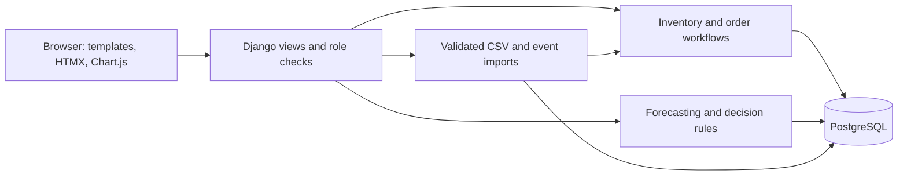

# Architecture and scope

SupplyPilot is a modular Django application with a PostgreSQL database. HTML is rendered on the server; HTMX updates
inventory results and Chart.js renders charts from JSON emitted by the authenticated page. Bootstrap and custom CSS
are vendored. A single Python runtime handles web requests, analytics, CSV imports, and management commands.

## Domain boundaries

- Identity: Django users, sessions, groups, permissions, password hashing and CSRF protection.
- Catalog: supplier, warehouse, product; foreign keys protect referenced records.
- Inventory: one balance per product/location, reserved stock, immutable application stock ledger.
- Demand: one sales record per location/date; saved forecasts retain method, MAE and daily values.
- Decisions: recommendations preserve input snapshots; only Pending can become Approved, Rejected or Overridden.
- Fulfilment: purchase orders contain shipment state, delivery dates, receipt quantities and disruption history.
- Observability: audit entries, accepted/rejected integration events and per-user alert read state.

Services are separated as Python modules within one deployment. Extracting a service later remains possible, but this
implementation does not claim independent service deployment, horizontal per-service scaling or process-level fault isolation.

## Integrity and concurrency

Database constraints enforce one inventory position per location/product, one daily sales record, one pending recommendation
per inventory position and one purchase order per recommendation. Quantities, costs and reserved-stock relationships are constrained.
Django foreign keys create indexes; additional indexes support forecast lookup and workflow status filters.

PostgreSQL transactions lock the inventory position before recommendation/order rows. This serializes approvals, inventory
adjustments, receipts and imports for the same stock position. Decisions and draft orders commit together; receipts and stock
movements commit together. Duplicate event IDs cannot be inserted twice. Failed CSV validation leaves all inventory unchanged.
SQLite is a single-user fallback; it does not provide PostgreSQL row-lock semantics.

## Proposed SRS revisions

These are implementation decisions to reconcile with the lab requirements, not edits to the original PDFs.

| Requirement | Prototype interpretation / proposed revision |
|---|---|
| NFR-01 monitoring latency | Refresh inventory every 30 seconds; update operational alerts after writes/planning |
| NFR-02 scaling | Support a measured prototype workload; defer independent-service horizontal scaling |
| NFR-03 availability | Controlled request failures and atomic writes; defer independent-service failure isolation |
| NFR-04 reliability | Transactional processing and event replay protection |
| NFR-05 security | Session authentication, group authorization, CSRF, password hashing, throttling and HTTPS deployment settings |
| NFR-06 consistency | Database constraints, row locks, unique event IDs and receipt ledger |
| NFR-07 usability | Responsive role-aware dashboard, explicit empty/error states and readable decision evidence |
| NFR-08 maintainability | Modular monolith; one deployable application with separate service modules |
| NFR-09 extensibility | Forecast model selection and planning logic live in isolated analytics functions |
| NFR-10 portability | Docker Compose for web + PostgreSQL; local Python launcher |

## Functional traceability

| Requirement | Implementation |
|---|---|
| FR-01 Authentication | Sign-in, sign-out, password change, Django account admin, login throttling |
| FR-02 Role access | Planner, Manager, Administrator groups checked on every operational route |
| FR-03 Inventory | Multi-location balances, search/filters, adjustment ledger, atomic CSV imports |
| FR-04 Optimization | Safety stock, reorder point, inventory-position-aware replenishment quantities |
| FR-05 Forecasting | 7/30/90-day forecasts, history requirements, holdout model evaluation |
| FR-06 Supplier risk | Observed on-time delivery, fulfilment and disruption scoring |
| FR-07 Orders/shipments | Draft-to-delivered lifecycle, delay alerts, receipt posting |
| FR-08 Decisions | Priority, demand/supplier/stock evidence, persisted recommended quantity |
| FR-09 Analytics/alerts | Overview, demand charts, stock alerts, delay alerts, period reports, CSV exports |
| FR-10 Recommendation management | Approve/reject, manager override with reason, audit history, stale-state checks |

## Limits

- ERP/logistics integration is a validated session-authenticated endpoint and CSV interface, not a live vendor connector.
- Purchase orders are internal records; external communication, payments and transport booking are out of scope.
- Forecasts are statistical point estimates with fixed lead-time assumptions, not guaranteed outcomes or calibrated intervals.
- No email/SMS delivery, distributed job broker, automatic cloud publication, multi-tenant isolation or external single sign-on.
- Reports expose all operational data to authorized managers; fine-grained warehouse assignments are a future extension.
- An HTTPS deployment and actual failure/recovery infrastructure tests are necessary before production use.
